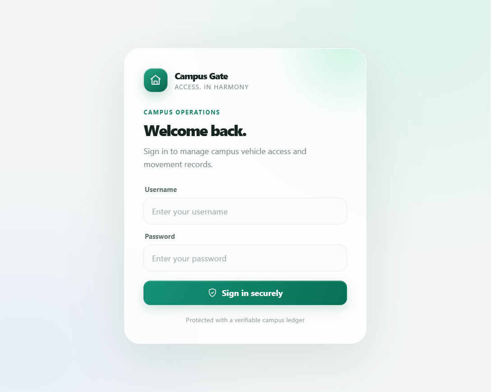
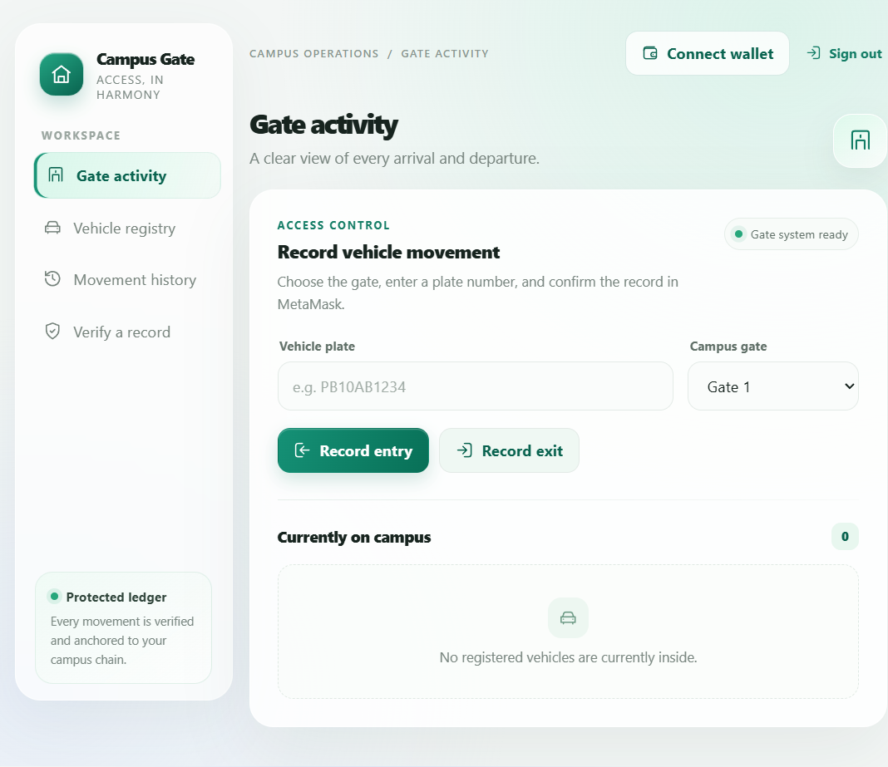

# Campus Gate

A campus vehicle access system with a React interface, Express/MongoDB API, MetaMask-signed transactions, and a Solidity audit log.

## Screenshots

| Secure sign-in | Gate operations |
|---|---|
|  |  |

The interface adapts to mobile screens and honors the operating system's reduced-motion preference.

## Features

- Separate administrator and guard sign-ins.
- Register vehicles with owner details in MongoDB; store only a salted plate hash on-chain.
- Connect MetaMask and sign registration, entry, and exit transactions directly.
- View gate activity, currently-inside vehicles, and verify cached records against transaction receipts and the contract.
- Responsive interface, accessible controls, animated feedback, and a reduced-motion mode.
- Render deployment blueprint with a health check and production configuration validation.

## Requirements

- Node.js 22.12 or newer
- MongoDB (local or Atlas)
- MetaMask
- A compatible EVM RPC endpoint and funded deployer account for the network you select

## Local development

From the project root:

```powershell
npm ci
npm ci --prefix backend
npm ci --prefix frontend
Copy-Item backend\.env.example backend\.env
```

Edit `backend\.env`:

- Set `MONGO_URI` to your own MongoDB connection string and database name.
- Set a random `PLATE_SALT` and `JWT_SECRET`.
- Set `METAMASK_ADDRESS` to your wallet's **public address**.
- Keep `RPC_URL=http://127.0.0.1:8545` and `CHAIN_ID=31337` for the local Hardhat chain.
- Never store or share a wallet recovery phrase. Do not use Hardhat's public test keys on a public network.

Start a local blockchain and deploy the contract in separate terminals:

```powershell
npm run node
npm run deploy
```

Then start the API and frontend:

```powershell
npm start
npm run dev --prefix frontend
```

Open `http://localhost:5173`. Connect the MetaMask account configured as `METAMASK_ADDRESS`; the app prompts MetaMask to add/switch to Hardhat Local.

For local development only, the example credentials are `admin` / `admin123` and `guard` / `guard123`. Replace them before any shared or hosted deployment.

## Deploying a real contract

Choose the EVM network deliberately and use its official RPC provider. A public-chain deployment is permanent and requires real funds for gas.

1. In `backend\.env`, set the network's `RPC_URL`, numeric `CHAIN_ID`, `METAMASK_ADDRESS` (the intended admin/guard account), and `DEPLOYER_PRIVATE_KEY` (a dedicated deployer key funded only for deployment).
2. Deploy from a trusted local machine:

   ```powershell
   npm run deploy:configured
   ```

3. Record the printed contract address. Set it as `CONTRACT_ADDRESS` in the runtime environment.
4. The deployment script grants the MetaMask account the contract roles and removes the deployer admin role. It does not send funds on public networks.
5. Keep `DEPLOYER_PRIVATE_KEY` out of Render, Git, screenshots, and chat. The running application uses MetaMask for user transactions and does not need the deployer key.

Verify the selected network, wallet address, contract address, and deployment transaction before using real assets or operational data.

## Deploying to Render

This project includes [`render.yaml`](render.yaml) for a single Node web service that builds the Solidity ABI and frontend, serves the app and API together, and checks `/api/health`.

1. Push the project to the GitHub repository you intend to deploy from. Use a private repository if the source or operational details should not be public; never commit credentials or secrets.
2. In Render, create a Blueprint from that repository and review the service plan and cost before creating it.
3. Set the Blueprint's `MONGO_URI`, server-side `RPC_URL`, browser-accessible `PUBLIC_RPC_URL`, `CHAIN_ID`, `CONTRACT_ADDRESS`, `ADMIN_USER`, `ADMIN_PASS`, `GUARD_USER`, and `GUARD_PASS` values in Render's environment settings. Use a public RPC URL intended for browser use; do not expose a server-only RPC credential.
4. Use unique usernames, passwords at least 12 characters long, and keep the generated `PLATE_SALT` / `JWT_SECRET`. In MongoDB Atlas, grant the app's network access and a least-privilege database user.
5. Deploy and wait for `/api/health` to report healthy. Open the Render URL, install/connect MetaMask, and switch to the exact chain used for the contract.

**Production safety:** Never commit `.env` files, API credentials, private keys, or recovery phrases. Rotate any credentials that have been shared. The hosted app fails startup on unsafe default passwords, incorrect chain ID, missing contract code, or invalid configuration. Restrict Atlas network access rather than allowing all IPs if your hosting plan supports stable outbound IPs.

## Checks

```powershell
npm test
npm run build
npm audit --omit=dev
npm audit --prefix backend
npm audit --prefix frontend
```

Restarting the local Hardhat node resets its chain and contract. Redeploy it before testing again. Clear only the dedicated local test collections if you want to reset sample records.
